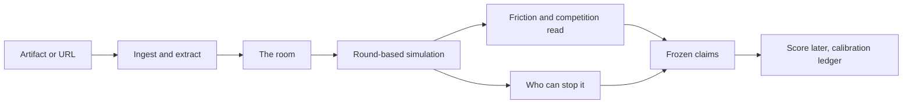

<div align="center">

# Strategic Arena

### Understand the landscape before investing valuable resources

[](LICENSE)
[](#what-local-first-means)
[](#what-local-first-means)
[](#what-local-first-means)

[Credits & sources](CREDITS.md) · [Security policy](SECURITY.md) · [Contributing](CONTRIBUTING.md) · [Design notes](docs/UI.md)


</div>

> Strategic Arena is a multi-agent simulation plugin for Hermes that ingests GitHub repos, arXiv
> research papers, tech blogs, and announcements to model real-world ecosystem friction. It maps
> out who will block adoption, simulates competitor reactions, and stress-tests your strategy
> before you commit engineering time or capital. Point it at a repo, a paper, a blog post, a case
> study or an announcement — yours or someone else's.
>
> **Not a prediction. Not a guarantee. A scored read of the room.**

**In plain English.** You are about to spend real money or engineering time on something — or
someone else just did, and you need to read it before you respond. Paste the link. Two to five
minutes for a three-round read, under half an hour for a full cycle, and you get the landscape it
lands in: the parties who decide what happens next, the ones who can stop it, the ones who will
amplify it, the ones who can only complain, what each of them actually wants, and how contested the
ground already is. That is a decision you can defend, for about two cents on a cheap model.

### See it — one link in. The room it lands in, and the price of every objection.


<!-- DEMO VIDEO — drop the file here and uncomment. Record with docs/DEMO-SCRIPT.md.
<video src="assets/demo.mp4" poster="assets/how-it-works.png?v=2026-11-11b" controls muted
       width="100%" aria-label="Strategic Arena — 90 second demo"></video>
-->

Two minutes, one link, no account. The demo path is the point: **open the plugin, land on a
finished, scored session in one click** — what it meant, the call, what each party was worth, and
the claim that got graded. The recording is scripted beat by beat in
[`docs/DEMO-SCRIPT.md`](docs/DEMO-SCRIPT.md).

### What it is — and what it is not

**What it is:** a reception read for an artifact. You hand it a link or the text; it staffs the room
that will answer it, runs the debate, and hands back the landscape: what the request means, who is
for it and who can stop it, how contested the ground already is, and what each concession buys. Then
it writes down testable claims with dates and lets you score them later, so the record gets sharper
with every run.

**What it is not:** a prediction, a guarantee, a game solver, or a forecast. It does not tell you
what *will* happen. MASS's own boundary rule: LLM-driven simulation produces *pre-experimental
evidence* — mechanism exploration, counterfactual contrast, risk identification. What it does claim
is a **scored track record**: every run freezes claims, every claim can be scored, and the
calibration ledger shows hit rate and friction error over N runs.

### What comes back

| | comes back | means |
|---|---|---|
| 1 | **What it means** | the request read plainly: the claim, what it displaces, the opening it creates for you |
| 2 | **The room** | who actually reacts — customers, competitors, partners, the marketplace that would list you — named, from your own text |
| 3 | **Who decides** | the parties with real power over the outcome: who can veto it, who can amplify it, who can only complain |
| 4 | **The field** | how contested the ground already is, and whether you will be read as a new category, another entrant, or noise |
| 5 | **The price** | what each concession buys, computed from the room |
| 6 | **The record** | claims frozen with dates, scored when the window closes |

Under that: a **friction score** (0–100, ± uncertainty that comes from *input quality*, not from a
claim of predictive accuracy — a structured hypothesis, **not a calibrated probability of a real-world
outcome**); **provenance** on every stance ("grounded" text vs "speculated" reasoning); **2–4 frozen
claims** written to `log.jsonl` with a replication manifest (model, temperature, prompt hash, document
hashes, code commit) so a run can be audited and repeated; and a **track record** — hit rate, friction
error and the sea-state mix. The hit rate is the accuracy claim; a single report is not.

### The lens — the medium sets the room

Reception depends on what you handed in, so the extraction question changes with it:

| You give it | The room it staffs |
|---|---|
| a **repo / README** | maintainers, security and supply-chain reviewers, downstream developers, the project it displaces, the registry that lists it |
| a **blog post** | the reader who quotes it back, the competitor it attacks, the parties it cites, the curator who decides if it travels |
| a **whitepaper** | the reviewer who checks the method, procurement, the peer it extends or contradicts, the implementer |
| a **research paper** (arXiv, DOI) | the **market**: the incumbent it attacks, the fast follower who can ship it, the buyer with the budget, the integrator whose switching cost is the moat, the channel, and the authors' own lab — plus a **moat decode** and a replication clock (below) |
| a **case study** | the named customer (whose approval is itself a gate), the buyer who needs a comparable, procurement, the competitor in the same evaluation |
| a **press release** | the journalist, the incumbent, the regulator, existing customers |
| a **tweet** | the reply-guy finding the weakest clause, the quote-tweeter reframing it, the silent majority, the account it names |
| an **internal decision** | approvers with a veto, the teams whose work changes, customers, the market it enters |

The lens is detected from the link (`github.com` → repo, `x.com` → tweet, `arxiv`/`doi.org` → paper,
`.pdf` → whitepaper, `/blog/` → post) and can be set by hand in the dialog.

#### A research paper is read twice

A paper is the one artifact where **the document is the moat giveaway**: publishing is the moment a
technique becomes copyable. So `kind: paper` answers a different question from `whitepaper` (which
asks whether the method is defensible), and it runs an extra pass before the room is drawn:

| decoded from the text | why it changes the answer |
|---|---|
| **product** + **buyer** | a paper contains no product; this is the conversion step |
| **disclosed** vs **tacit** | what a stranger can rebuild from the PDF, and what they must still guess |
| **replication_months** | how long a funded competitor needs — the clock, and the answer to "how would the market take it" |
| **scale_dependence** | does the result hold at a fraction of the compute, or only at three labs' worth |
| **nearest prior art** + **authors' position** | who is one paper away — usually the authors themselves |

The clock is **computed in code from those facts, never asked of the model** (`moat.clock_for`), so
the same paper cannot land in two bands. `<= 3 months` is *commodity* (a feature, not a company),
`<= 9` is *contested*, longer is *protected* only when something the paper withholds explains the gap,
and an unstated time is **unknown** — never *protected*. The decode goes back into the run as a
context document, because every party in that room has read the same public paper.

The interface says all of this before you run, in the panel that appears when you pick the lens:

| | The other lenses | A research paper |
|---|---|---|
| the question | will this land, and who can stop it | what could be built from this, and how long is it safe |
| the room | the people who react to what you are about to do | the market that would receive the product — including the authors |
| you get back | friction, the party who can stop it, what each concession buys | the product and the buyer, gives-away vs holds-back, the replication clock |

Then the refusal, in the same panel: not a peer review, not a forecast, no revenue and no market share.

## How it works

A multi-agent simulation runs the room in rounds: extract, staff, argue, price, freeze.



Eleven research ideas, named in [CREDITS.md](CREDITS.md) with an identifier and license status each.
What each powers here:

| Research | What it powers here |
|---|---|
| **GraphRAG** (Edge et al.) | document → party/relationship extraction; camp clusters |
| **Generative Agents** (Park et al.) | per-party memory stream, retrieval, periodic reflection |
| **OASIS** (arXiv:2411.11581) | the round-based loop and social action types |
| **MASS** (Hu and Shen, 2026) | replication manifest, scheduling discipline, failure-mode audit |
| **CAMEL** (Li et al.) | role-play framing + inception-style prompt templates |
| **Shapley counterfactual credits** (2106.00285) + **Shapley 1953** | the ledger: each party neutralized in turn, exact over every coalition |
| **Forecasting calibration** (2507.04562, 2402.18563) | Brier scoring of the frozen claims — a skill score, not a hit rate |
| **Virtual respondents** (2509.06337) | how a party's stance is elicited from a document, not invented |
| **Negotiation benchmarking** (2603.14066) | how a condition is read as a concession with a cost |
| **Market regime council** (2605.24490) | when two parties behave as one blocking unit |

### What "local-first" means

Everything runs on **your own machine**. Documents and results stay in
`<hermes home>/plugin-data/strategic-arena/` (per-profile when multiplexing), and the graph and every
past run live there too — no cloud graph service, no Zep, no Docker. Nothing is sent to a cloud
service, no account is required, no telemetry. Runs on **your active Hermes model** via `ctx.llm` —
the plugin never sees or stores a credential — and you can unplug from the internet and still run a
review on a local model.

## Quickstart — one review, start to finish

1. **Install and enable** the plugin (see *Install*), then open **Strategic Arena** in the left sidebar.
2. Press the brand-blue **`+ Start arena session`** button. Staring at a blank form is the wrong way in
   — press a **recipe** instead (`Launch / adoption`, `Price change`, `Deprecation`, `Open-weight
   release`, `Reputation / crisis`). It fills every field with a skeleton you edit.
3. **Replace the placeholders with your real move.** A complete, working example:

```text
Title: Open-weight Arete-27B

Decision document:
Nous is considering open-weighting Arete-27B. The weights ship under a permissive license on
release day, with the full training data and eval suite published alongside. The hosted API
stays free for the first 90 days so people can try it before committing.

Evidence:
Q2 survey of 400 enterprise CIOs: 61% said they cannot route inference through an external API
for compliance reasons, and open-weight model downloads tripled quarter over quarter. Community
fine-tunes now outnumber closed-model adaptations 3:1. Finance has reservations: it wants the
90-day free API window capped at a fixed budget before it will sign off. Two enterprise resellers
have asked for a protection clause, which they call a fixable detail rather than a veto. Legal needs
the two vendor data licenses cleared before the training set can be published.
```

The example is written to show a real fight, not a room where everyone agrees: one party with a lever
and a condition, one fixable complaint, one compliance condition, and the people who gain.

4. **Pick a timeline** (`24 hours` is the recommended default). The form shows the run's arithmetic —
   `4 hours — 8 rounds · ≈10–12 min · ≈50 calls`: tokens always, money only when the public catalog
   publishes a price for the exact model your session is on. There is no model picker.
5. **Run review.** In this order: a competition read, the friction bar, the party who can stop it, the
   room board, the report, and 2–4 **frozen claims** to score later.

```text
Friction : 46 / 100  (±3, high confidence)
Sea      : Red ocean — competition high (2 blocking camps)
Blocker  : Legal (−0.50, capacity 0.9) — needs the two vendor data licenses cleared
           before the training set can be published
Claims   : 11  → binding_constraint · friction_band · blocking_camp · extracted
```

That is a real run on the example above (live model, 16 rounds). The color moves between **Purple** and
**Red** between runs — the model's read of who will fight is not a coin flip you can fix in copy, and
pretending otherwise is what makes a prediction product a lie. What is stable: the parties are named,
their capacity to stop the move is stated, and their conditions are printed as sentences you can act on.

6. **Run it again at a different timeline** (`30m`, `4h`, `24h`) — the comparison panel tells you whether
   the read is stable across timelines or moves with how long you let it run. That is the difference
   between a one-off report and evidence.

## What to feed it (and what hurts)

Best results come from documents that **contain a real disagreement**:

- ✅ **A decision + an evidence document.** The plan states the move; the evidence (real numbers,
  quotes, sources) is what turns "simulated" into "grounded." The single biggest driver of quality.
- ✅ **URLs are fine** — a blog post, a repo README, a landing page, a pricing page, a forum thread, a
  PDF. The plugin fetches them to text and ingests them, keeping the URL as provenance.
- ⚠️ **Opinion with no source** → stances become guesswork, confidence drops. **Marketing copy with no
  substance** → nothing to ground on. **A document that assumes consensus** → the tool correctly
  reports low friction.

Two sources that disagree beat five that agree. A decision plus one piece of real evidence is the best
cheap run — and the plugin says so out loud when a run comes back thin.

## Which model, and what a run costs

**A run uses the model the session is already on.** The form reads it from the app's own state and
shows it, read-only. There is no picker, and that is a decision rather than a gap: a picker needs a
live catalog over the network plus a host permission the desktop app does not grant, and when either
failed the form said one thing while the run did another. The honest fix was to stop asking.

It does not need a frontier model. The work is many small structured judgments — open to act, nudge a
stance, summarize a few memories — not one hard reasoning problem. A cheap, fast flash-class model is
the right buy: a big reasoning model makes the simulation *slower*, not smarter.

What the form does show is the run's arithmetic, before you commit:

```text
4 hours — 8 rounds · ≈10–12 min · ≈50 calls
≈80k tokens in / ≈7k tokens out, at about 6 parties
```

| Timeline | Rounds | What the form says it takes |
|---|---|---|
| 30 minutes | 3 | 2–5 min |
| 1 hour | 5 | 4–8 min |
| 4 hours | 8 | 6–12 min |
| 6 hours | 10 | 8–15 min |
| 12 hours | 12 | 10–20 min |
| 24 hours | 16 | 15–30 min — the default |
| 48 hours | 20 | 25–45 min |

Those are the app's own estimates, shown before the run. A large paper adds ingest and decode time, a
rate-limited free model can roughly double the band, and a bigger room means more calls per round.

- **Tokens always; money only when it is published.** Money appears when the public Nous catalog
  publishes a price for *that exact model* (`≈$0.016 at the published price`), and when it does not the
  form says nothing about money rather than multiplying by an invented number. A model the catalog
  does not carry is a real case, and "price unknown" is the honest answer there.
- **After the run, the real number.** The host reports actual usage and its own cost estimate per
  call; the run prints `38 calls, 41k tokens · $0.021 spent`. That is the number to trust.
- **The window is bounded**, so the estimate does not drift with the document's length: it is windowed
  to a fixed prompt budget, head and tail, omitted middle marked (`ingestion.excerpt`).
- **The timeline is suggested, not defaulted** — seven options with no recommendation is a coin flip,
  so the form reads the input and marks one *suggested*, with the reason in one sentence.
- **The long end is honest.** Positions stop moving after about 8–10 rounds; past that the extra rounds
  re-argue settled ground, and the form says so instead of selling 48 hours as "deepest."

## Install

Plugins only load when enabled. Desktop: **Capabilities → Plugins → Strategic Arena → enable**, then
it appears in the left sidebar. CLI:

```bash
hermes plugins install /path/to/strategic-arena   # or by catalog name once listed
hermes plugins enable strategic-arena
```

The desktop half is opt-in by design: it inventories in Capabilities → Plugins and stays off until you
switch it on. That is the marketplace pattern — install, then enable.

### When the UI looks stale (it happened — twice)

The app reads `desktop/plugin.js` at load, and toggling the plugin **does not** re-read it, so "I
updated the plugin" and "this window shows the new build" are two different things. The header prints
a build badge — `build <BUILD>`, or `build <running> → <installed> installed` when they differ, plus a
callout. Fix: **Reload UI** in the header, or `⌘K` → **Reload desktop plugins**, or toggle the plugin
off and on, or quit the app fully and relaunch. If a toggle hangs ~30s a stale plugin-host child holds
the RPC: `pkill -f plugin_host_child` and retry (a Hermes process issue, not a plugin bug).

### App on one machine, Hermes on another (remote backend)

The desktop half is **local to the machine the app runs on**. Against a remote gateway the remote
box's `~/.hermes/plugins` is not a reachable filesystem, so only locally installed packages
contribute a desktop half by copy — a documented Hermes case, not a plugin quirk (see the SDK guide,
*One package, both SDKs*). On a remote setup, install the **desktop target on the machine running the
app**: **Capabilities → Plugins → Install from Git** → `trillionverselabs-boop/strategic-arena`, with
the **Desktop** component checked; the agent half stays on the server. Until that clone exists the
Plugins page shows the Desktop half as **unavailable (remote backend)** — that state is the diagnosis,
and a stale local copy is the other one.

### Where data lives, and uninstalling

Run history, the graph, the manifests and the calibration ledger live in
`<hermes home>/plugin-data/strategic-arena/`, which survives updates and removal and follows the
active profile. `hermes plugins remove strategic-arena` leaves 18 paths behind (dependency venvs,
source snapshots, run history), so use the one-command purge and its built-in proof:

```bash
hermes plugins remove strategic-arena
python3 scripts/uninstall-clean.py strategic-arena      # add --keep-data to keep run history
```

Full detail: [`docs/UNINSTALL.md`](docs/UNINSTALL.md).

## Catalog disclosure (admission rule 13)

- **Network calls:** to the inference endpoint serving your active Hermes model (via `ctx.llm`); to the
  public Nous model catalog (`inference-api.nousresearch.com/v1/models`, anonymous, no credentials,
  cached 6h) **only to read the price of the model you are already on** — it can never select one; and,
  only when you provide URLs, to fetch those URLs as text (http/https only, size and length capped,
  hard timeout). If the catalog is unreachable the form shows tokens and no money; nothing about a run
  depends on it.
- **Background processes:** a simulation runs in a background thread while it streams progress to the
  desktop UI. No long-running daemon, no auto-update, no telemetry.
- **Dependencies:** the manifest declares **none**, deliberately. The only third-party modules the
  shipped code imports are `pydantic` and `fastapi`, which Hermes itself requires and pins
  (`pydantic==2.14.1`, `fastapi>=0.104,<1`); restating them would ask a user to install what they
  already have and would let a plugin's floor try to move Hermes's exact pins (rule 10).
  `tests/test_packaging_declares_nothing.py` checks the imported set against Hermes's own list, so
  this is proved rather than argued — and it keeps the desktop's non-interactive Install from Git
  dialog from stopping at a dependency-consent prompt it cannot answer.
- **Data:** reads and writes live only under `<hermes home>/plugin-data/strategic-arena/` (graph + run
  history) plus the plugin's own package files. Nothing leaves the machine except the calls above.
- **UI build readback:** `GET /ui` reads this plugin's own `desktop/plugin.js` and the app-level copy
  at `<hermes home>/desktop-plugins/strategic-arena/plugin.js` — outside the plugin's data directory,
  but of this plugin's own file only — so the header can tell you the window is stale. `POST
  /ui/refresh` writes nothing; **Reload UI** just reloads the page, and the app's own scan re-copies
  the desktop half.
- **Credentials:** none stored, none read. All model access goes through the host's own `PluginLlm`
  facade — the object `ctx.llm` is built from
  (`agent.plugin_llm.PluginLlm(plugin_id="strategic-arena")`), used by the backend routes in a process
  that never saw `register(ctx)`. The plugin never reads `.env`, `auth.json` or any vendor token file
  (rule 11), and never builds an `Authorization` header itself.

## Repo layout

```
strategic-arena/             # the product, and the plugin id (`strategic-arena`)
├── plugin.yaml              # manifest: name, provides_tools, requires_hermes
├── __init__.py              # register(ctx): tools + ctx.llm bind
├── LICENSE                  # MIT — copyright Lisa Martin (LeMultiFox)
├── CREDITS.md               # every paper we implement, with ids and license status
├── dashboard/plugin_api.py  # FastAPI at /api/plugins/strategic-arena/ — /run /status /report
│                            #   /graph /claims /events /leverage /history /calibration /due
│                            #   /verify /compare /ui /health
├── desktop/plugin.js        # the whole desktop UI — uncompiled ESM, no JSX, no build
├── skills/  assets/  docs/  tests/   # presets, diagrams (drawn here, MIT), notes, suite (~5s)
└── engine modules:
    ingestion.py artifact → parties (+ the lens)   moat.py  paper → product + clock
    agents.py    memory, retrieval, reflection     simulation.py  the round loop
    camps.py     coalition detection               leverage.py    exact Shapley per party
    claims.py    frozen claims + Brier scoring     graph.py       provenance spans → parties
    reporting.py run storage, history, ledger      engine.py      orchestration, cancel, inject
    tools.py     the seven agent tools
```

**Tools exposed:** `arena_run` · `arena_status(run_id)` · `arena_report(run_id)` ·
`arena_history([limit])` · `arena_calibration()` (runs, hit rate, friction error) ·
`arena_due([as_of])` · `arena_export`.

**Bundled skills** (registered under the plugin namespace while it is enabled): `launch` · `pricing` ·
`deprecation` · `openweight` · `review` — closing the loop by scoring claims at the window close.

## Who built this

**LeMultiFox** — the handle I use in the [Nous Research Discord](https://discord.gg/nousresearch),
where this plugin was built and where I answer questions about it.

Three names, three jobs, and none of them hides behind another:

| | | |
|---|---|---|
| **LeMultiFox** | the author | the handle the community knows; credit and questions live here |
| **TrillionVerse Labs** | the studio | the name the work is made under |
| **Lisa Martin** | the copyright holder | owns this code personally; the license grant is hers |
| **LDMA Partners** | the payout entity | receives prize and commercial payments where applicable — not the copyright holder |

The code is mine, personally: the copyright and the license grant are the author's, and neither moves without a written assignment.

I built it because I kept doing the same thing badly: shipping a post, a launch, a README, and finding
out who it annoyed *after* it was public. Everything here is the tool I wanted — a room of the people
who will actually react, a price on every objection, and a written claim I have to grade afterwards.
Two rules held to while building it, because they are the difference between a demo and something you
can put in front of a legal team:

- **No invented numbers.** When the heat function turned out to be additive, the coalition interaction
  figure in the design mockup was deleted rather than fabricated — `tests/test_ui_ledger.py` fails the
  build if it comes back.
- **The record can be wrong in public.** Claims are frozen with dates and scored; the track record
  prints its own `n`, however thin that `n` is.

MIT licensed, local-first, no account, no telemetry.

## Credits and licenses

Strategic Arena is a **clean-room implementation**. No code is vendored from any paper or project we
cite — every line here is ours, MIT-licensed. The ideas are theirs: the full list with links, what we
take from each, and the license status of each source lives in **[CREDITS.md](CREDITS.md)**.

**MiroFish** ([666ghj/MiroFish](https://github.com/666ghj/MiroFish)) explores the same territory with a
much larger footprint, and it is **AGPL-3.0**. This repository is **MIT** and contains **no MiroFish
code, no MiroFish assets and no copied files** — the overlap is the *idea* (test a move against
synthetic respondents before you ship), which is not copyrightable. If you want the bigger tool, go
support MiroFish too; the two are complementary, not duplicates. If you believe an idea of yours is
used here without credit, open an issue and we will fix it — with a citation, and if any code is
involved, with a license change, not an excuse.

### Develop / run as a test

Tests run through `scripts/test.sh`, not bare `pytest`: the repository root is a Python package, and
pytest walks parent directories containing `__init__.py`, so a checkout named `strategic-arena` breaks
the import. Python ≥3.11:

```bash
pip install -e ".[test]"                    # dev + runtime deps
./scripts/test.sh                           # the suite, from any checkout folder name
hermes plugins validate . --install-deps    # the catalog check, locally
```
