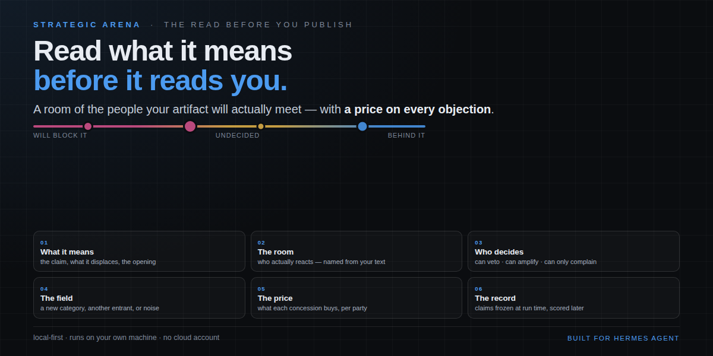
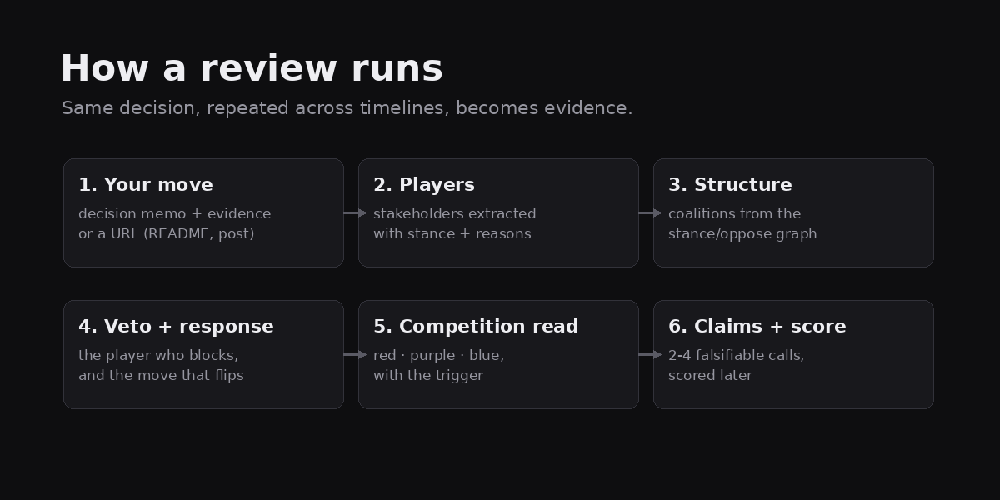
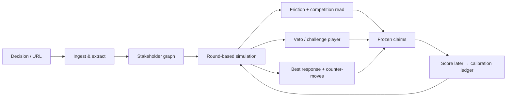

# Strategic Arena (`upfront`)




> **Read what it means before it reads you.**
>
> Give it a link — a repo README, a blog post, a whitepaper, a case study, a press
> release, a tweet — and it opens a room of the people who will actually react.
> It names who holds real power over the outcome (who can block it, who can
> amplify it, who can only complain), prices each party's leverage against the
> room's own friction, and shows what each concession buys. Then it freezes
> testable claims with dates and scores them, so the record argues for itself.
>
> **Not a prediction. Not a guarantee. A scored read of the room.**

### See it



Two minutes, one link, no account. The demo path is the point: **open the plugin,
land on a finished, scored session in one click** — what it meant, the call, what
each party was worth, and the claim that got graded.

<!-- DEMO VIDEO — drop the file here and uncomment. Record with docs/DEMO-SCRIPT.md.
<video src="assets/demo.mp4" poster="assets/how-it-works.png" controls muted
       width="100%" aria-label="Strategic Arena — 60 second demo"></video>
-->

*The screen recording goes here once the last round of testing lands. Until then,
`assets/how-it-works.png` above is the whole flow in one frame.*

### Why a room, not a chat

Most AI tools act as conversational search engines. Strategic Arena runs a
**deterministic 3-pass read** instead of asking a model to "summarize a link":

1. **Claim & fact extraction** — strips marketing fluff, PR spin, and slop to pull
   raw metrics and structural claims.
2. **Friction & coalition mapping** — simulates how customers, competitors, and
   internal teams react, surfacing hidden technical or market risks.
3. **Strategic synthesis & scorecard** — outputs an actionable competitive
   response and freezes testable claims you grade later.

### Use cases

**Business / GTM:** product & pricing changes (pushback, churn, counter-moves);
breaking announcements & PR (market signal vs. hype); M&A / vendor due
diligence (structural risk audit of a repo or whitepaper).

**Developers / AI engineers:** open-weight & model releases (benchmark, SFT,
license claims); architecture & dependency audits (integration friction, code
debt).

### What it is — and what it is not

**What it is:** a reception read for an artefact. You hand it a link or the text;
it staffs the room that will answer it, runs the debate, and hands back the
landscape: what the request means, who is for it and who can stop it, how
contested the ground already is, and what each concession buys. Then it writes
down testable claims with dates and lets you score them later, so the record gets
sharper with every run.

**What it is not:** a prediction, a guarantee, a game solver, or a forecast. It
does not tell you what *will* happen. It tells you what the room is likely to do
and who holds power over the outcome — a test before you publish.

```
Artefact → the room it lands in → who decides → the field → the price → claims frozen → scored later
```

### The contract — what comes back

| | comes back | means |
|---|---|---|
| 1 | **What it means** | the request read plainly: the claim, what it displaces, the opening it creates for you |
| 2 | **The room** | who actually reacts — customers, competitors, partners, the marketplace that would list you — named, from your own text |
| 3 | **Who decides** | the parties with real power over the outcome: who can veto it, who can amplify it, who can only complain |
| 4 | **The field** | how contested the ground already is, and whether you will be read as a new category, another entrant, or noise |
| 5 | **The price** | what each concession buys, computed from the room |
| 6 | **The record** | claims frozen with dates, scored when the window closes |

### The lens — the medium sets the room

Reception depends on what you handed in, so the extraction question changes with it:

| you give it | the room it staffs |
|---|---|
| a **repo / README** | maintainers, security and supply-chain reviewers, downstream developers, the project it displaces, the registry that lists it |
| a **blog post** | the reader who quotes it back, the competitor it attacks, the parties it cites, the curator who decides if it travels |
| a **whitepaper** | the reviewer who checks the method, procurement, the peer it extends or contradicts, the implementer |
| a **case study** | the named customer (whose approval is itself a gate), the buyer who needs a comparable, procurement, the competitor in the same evaluation |
| a **press release** | the journalist, the incumbent, the regulator, existing customers |
| a **tweet** | the reply-guy finding the weakest clause, the quote-tweeter reframing it, the silent majority, the account it names |
| an **internal decision** | approvers with a veto, the teams whose work changes, customers, the market it enters |

The lens is detected from the link (`github.com` → repo, `x.com` → tweet,
`arxiv`/`.pdf` → whitepaper, `/blog/` → post) and can be set by hand in the
dialog.

## At a glance

| | |
|---|---|
| **You give it** | a decision memo, or a URL (repo README · blog post · news article · pricing page · forum thread · whitepaper) |
| **You get** | veto player, coalitions, best response, competition read (red / purple / blue), frozen claims to score |
| **Cost** | free models available; a 48h review is ~$0.02 on a cheap paid model and the price is shown before you run |
| **Repeatable** | the same decision across 30m / 4h / 24h is compared automatically — repetition becomes evidence |
| **Not** | a prediction, a guarantee, or a game solver |

### What it is, in one sentence

Strategic Arena is a **reception read**: it opens the room of people your
decision affects will react, so you can see the blocking stakeholder, the
coalitions that form, and the move that flips them — before you commit.

### For developers

Under the hood it is a clean-room implementation of five research ideas
(GraphRAG, Generative Agents, OASIS, MASS, CAMEL) that runs entirely on your
machine. No cloud graph service, no Docker, no stored credentials — see
[How it works](#how-it-works) and the [repo layout](#repo-layout).

### What it is — and what it is not

**What it is:** a reception read for an artefact. You hand it a link or the text —
a README, a post, a whitepaper, a case study, an announcement, a tweet — and it
staffs the room that will answer it, runs the debate, and hands back the
landscape: what it means, who is for it and who can stop it, how contested the
ground is, and what each concession buys. Then it writes down testable claims
with dates and lets you score them later, so the record gets sharper with every
run.

**What it is not:** a prediction, a guarantee, a game solver, or a forecast. It
does not tell you what *will* happen. It tells you what the room is likely to do
and who holds power over the outcome — a test before you publish.

**Example cases it handles well:**
- **A product launch** — "We're open-weighting our model next Tuesday." Who
  pushes back (enterprise IT, regulators, competitors), what they want, and
  whether the ground is crowded or open.
- **A price change** — "We're doubling the API price for existing customers."
  Who challenges it, under what conditions they'd accept it, and your best
  counter-move.
- **A deprecation** — "We're removing the legacy API in 90 days." Who gets hurt,
  how loud the pushback is, and whether the notice window is enough.
- **An open-weight release** — "Weights ship under a permissive licence." Who
  gains, who loses, and how competitive that space already is.

### What "local-first" means

Everything runs on **your own machine**. Your decisions, documents, and results
stay in a folder on your computer (`~/.hermes/upfront/`). Nothing is sent to a
cloud service, no account is required, and no data leaves unless you choose to
fetch a URL or use your own model provider. You can unplug from the internet
and still run a review (using a local model).

### Credits and licences

Strategic Arena is a **clean-room implementation**. No code is vendored from any
paper or project below — every line in this repository is ours, MIT-licensed. The
ideas are theirs, and the full list with links, what we take from each, and the
licence status of each source lives in **[CREDITS.md](CREDITS.md)**.

**Papers (ideas only, no code):**

- **CAMEL** — Communicative Agents for "Mind" Exploration (Li et al., arXiv:2303.17760) — role framing, inception-style prompts, the role-flip/loop failure modes
- **OASIS** — Open Agent Social Interaction Simulations with One Million Agents (arXiv:2411.11581) — round-based loop, action taxonomy, propagation
- **MASS** — Multi-Agent Social Simulation protocol (Hu & Shen, 2026) — replication manifest, scheduling discipline, the 8 failure modes, and the "pre-experimental evidence" boundary
- **GraphRAG** — From Local to Global (Edge et al., arXiv:2404.16130) — entity/relationship/claim extraction with source spans
- **Generative Agents** — Interactive Simulacra of Human Behavior (Park et al., arXiv:2304.03442) — memory stream, recency/importance/relevance retrieval, reflection
- **Shapley Counterfactual Credits for MARL** (Li et al., arXiv:2106.00285) and **Market Regime Council** (Pei et al., arXiv:2605.24490) — the leverage ledger: exact Shapley attribution over the room's own friction function, and coalition interaction
- **Evaluating LLMs on Real-World Forecasting Against Expert Forecasters** (Lu, arXiv:2507.04562) and **Approaching Human-Level Forecasting with LMs** (Halawi et al., arXiv:2402.18563) — Brier-scored claims, calibration as the honesty layer
- **A Benchmark for Multi-Party Negotiation Games** (Benac et al., arXiv:2603.14066) and **LLMs as Virtual Survey Respondents** (Zhao et al., arXiv:2509.06337) — validation targets for multi-party rooms and simulated respondents
- **Shapley, L. S. (1953)**, *A Value for n-Person Games* — the attribution itself

**MiroFish** ([666ghj/MiroFish](https://github.com/666ghj/MiroFish)) explores the
same territory with a much larger footprint, and it is **AGPL-3.0**. This
repository is **MIT** and contains **no MiroFish code, no MiroFish assets and no
copied files** — the overlap is the *idea* (test a move against synthetic
respondents before you ship), which is not copyrightable. If you want the bigger
tool, go support MiroFish too; the two are complementary, not duplicates.

If you believe an idea of yours is used here without credit, open an issue and we
will fix it — with a citation, and if any code is involved, with a licence
change, not an excuse.

A landscape-level read, on a **left-to-right axis**: red on the left (high competition —
everyone fighting for the same fish), purple in the middle (medium — a real contest with
winnable ground, the common case), blue on the right (low — open water, *this is the good
end*). It is a different colour scale from per-stakeholder stance (red / amber / green),
so the two never get conflated.

### This is a review, not a forecast

MASS's own boundary rule: LLM-driven simulation produces *pre-experimental evidence* —
mechanism exploration, counterfactual contrast, risk identification. Strategic Arena never claims to
predict an outcome, solve a game, or find an equilibrium. What it does claim is a **scored
track record**: every run freezes claims, every claim can be scored, and the calibration
ledger shows hit rate and friction error over N runs.

## How it works



Under the hood it is a small, clean-room implementation of five research ideas:

| Research | What it powers here |
|---|---|
| **GraphRAG** (Edge et al.) | Document → stakeholder/relationship extraction; stakeholder camp clusters |
| **Generative Agents** (Park et al.) | Each stakeholder has a memory stream, retrieval, and periodic reflection |
| **OASIS** | The round-based simulation loop and social action types |
| **MASS** (Qian et al.) | Replication manifest, scheduling discipline, and the 8 known failure modes, reported per run |
| **CAMEL** | Role-play framing + inception-style prompt templates |

Everything is local-first: the graph and every past run are stored in `~/.hermes/upfront/`
on your machine. No cloud graph service, no Zep, no Docker. Runs on **your active Hermes
model** via `ctx.llm` — the plugin never sees or stores a credential.

## What you get back

- **Friction score** (0–100, ± uncertainty) — how hard this will land. The uncertainty comes
  from *input quality*, not from claiming predictive accuracy. This is a structured
  hypothesis grounded in your document, **not a calibrated probability of real-world outcome.**
- **A living stakeholder graph** — nodes colored by stance (red = against, green = for), edges
  for oppose/support. Pure React SVG, no library.
- **The blocker + counter-moves** — the single most dangerous stakeholder, why (traced to a
  sentence in your doc), and the move that flips them.
- **Provenance** — every stance cites the input text it came from ("grounded"), clearly
  separated from reasoning the model filled in ("speculated").
- **A competition read** — **Red ocean** (high), **Purple ocean** (medium), **Blue ocean**
  (low), with the trigger stated in words. Colour is never the only signal.
- **Frozen claims** — 2-4 falsifiable calls per run (veto player, friction band, coalition
  stability), written to `log.jsonl` with a **replication manifest** (model, temperature,
  prompt hash, document hashes, code commit) so the run can be audited and re-run.
- **A track record** — score the claims and the ledger reports claim hit rate, friction
  error, and the sea-state mix. The hit rate is the accuracy claim; a single report is not.

### Desktop experience (left sidebar → Strategic Arena)

The page opens on a header with a single green **`+ New review`** pill. Everything else is
history: past runs, their competition read, and the comparison across timelines.

**The form is a modal** (the layout of a task-creation dialog):

| Field | What it wants | Help text on screen |
|---|---|---|
| **Title** (required) | a short, specific name — `Open-weight Arete-27B` | "Add a title for your test — short and specific, the way you would say it out loud." |
| **Decision document** — **or** URLs | the plan being reacted to | "Paste the plan, launch note or proposal. Be concrete about what changes and for whom." A **Use a sample** button fills a realistic, good-result example. |
| **Evidence** (optional) | numbers, quotes, survey results | "The biggest driver of quality — anything factual a stakeholder would react to." |
| **URLs** (optional, one per line) | fetched as real documents, URL kept as provenance | lists what works: repo README · blog post · news article · product/landing page · pricing page · forum or Reddit thread · whitepaper/PDF · public internal memo |
| **Timeline** | `30m` → `48h` | states what each buys you (below) |
| **Model** | live catalogue, per-million prices, "free only" filter | "Leave on active model to use whatever Hermes already runs." |

**Decision document OR a URL — one is required.** The footer says so in words, and the
green **Run review** button stays disabled until one of them is present. Both is fine; a
URL alone is enough (a repo URL ingests its README).

**What you get** is spelled out inside the form, before you spend anything: a structured
review of the response to your move — who can veto it, which coalitions form, the best
response, how contested the ground is — and the explicit sentence that it is **not a
prediction and not a guarantee**, but a read that freezes its calls so you can score
them later.

**Timelines, and what more time buys:**

| Timeline | Rounds | What it gets you |
|---|---|---|
| 30 minutes | 3 | sanity check — does anyone care at all? cheapest |
| 1 hour | 5 | first reactions only; good for a fast no |
| 4 hours | 8 | positions form; catches the obvious blocker |
| 6 hours | 10 | coalitions start to show |
| 12 hours | 12 | counter-moves get tested |
| 24 hours | 16 | **recommended** — a full reaction cycle |
| 48 hours | 20 | deepest read; hard to move a veto player; ~2× cost |

The form also prints the cost of the run before you start it: `N model calls · ~$X at list
price` (or `FREE`).

**In progress:** progress bar + `Round N of M`, a live graph that updates every round, and
an **Inject ⚡** field — type a counter-move and it lands at the next round, mid-run.

**Finished:** competition axis (red → purple → blue, with the trigger in words), friction
bar, veto player, the graph, the report rendered as markdown, and the **claims with ✓/✗
scoring** plus an overall `right / partial / wrong` verdict.

**Comparison across timelines** — the feature that makes repetition evidence. Every run of
the same title is grouped: a table of *timeline · friction · competition · veto player ·
scored*, plus a reading:

```
Stable across timelines — the same veto player and a friction spread inside ±15.
Run it once more before you act on it.
```

If the answer moves with how long you run it, the panel says so and shows the stance drift
between the shortest and longest run. That is a finding, not a failure — and it is the
reason to run 30m, 4h and 24h on the same decision rather than trusting one report.

**Opt-in deep dive:** `upfront_report(run_id, full=true)` (or `GET /report/{id}?full=true`)
returns the long-form `report_full.md` — same grounded content, expanded with
per-stakeholder narratives, round-by-round trajectories, camp structure, and the MASS
failure-mode audit.

## Quickstart — one review, start to finish

1. **Install and enable** the plugin (see *Install*), then open **Strategic Arena** in the left sidebar.
2. Press the green **`+ New review`** pill. Staring at a blank form is the wrong way in — press a
   **recipe** instead (`Launch / adoption`, `Price change`, `Deprecation`, `Open-weight release`,
   `Reputation / crisis`). It fills every field with a skeleton you edit.
3. **Replace the placeholders with your real move.** Here is a complete, working example:

```text
Title: Open-weight Arete-27B

Decision document:
Nous is considering open-weighting Arete-27B. The weights ship under a permissive licence on
release day, with the full training data and eval suite published alongside. The hosted API
stays free for the first 90 days so people can try it before committing.

Evidence:
Q2 survey of 400 enterprise CIOs: 61% said they cannot route inference through an external API
for compliance reasons, and open-weight model downloads tripled quarter over quarter. Community
fine-tunes now outnumber closed-model adaptations 3:1. Finance has reservations: it wants the
90-day free API window capped at a fixed budget before it will sign off. Two enterprise resellers
have asked for a protection clause, which they call a fixable detail rather than a veto. Legal needs
the two vendor data licences cleared before the training set can be published.
```

The example is written to show a real fight, not a room where everyone agrees: one party with a
lever and a condition, one fixable complaint, one compliance condition, and the people who gain.
That is what the record is for.

4. **Pick a timeline** (`24 hours` is the recommended default) and a model — the form prints
   `176 model calls · ~$0.02 at list price` (or `FREE`) before you commit.
5. **Run review.** You get, in this order: a competition read, the friction bar, the challenge
   player, the stakeholder graph, the report, and 2–4 **frozen claims** to score later.

A real run on the example above (live model, 16 rounds):

```text
Friction : 46 / 100  (±3, high confidence)
Sea      : Red ocean — competition high (2 blocking camps)
Challenge: Legal (−0.50, capacity 0.9) — needs the two vendor data licences cleared
           before the training set can be published
Claims   : 11  → binding_constraint · friction_band · blocking_camp · extracted
```

The colour moves between **Purple** and **Red** between runs — the model's read of who will fight
is not a coin flip you can fix in copy, and pretending otherwise is what makes a prediction
product a lie. What is stable is that the players are named, their capacity to stop the move is
stated, and their conditions are printed as sentences you can act on.

6. **Run it again at a different timeline** (`30m`, `4h`, `24h`) — the comparison panel appears
   under the result and tells you whether the read is stable across timelines or moves with how
   long you let it run. That is the difference between a one-off report and evidence.

### Uninstalling

`hermes plugins remove upfront` leaves 18 paths behind (dependency venvs, source
snapshots, run history). Use the one-command purge and its built-in proof:

```bash
hermes plugins remove upfront
python3 scripts/uninstall-clean.py upfront      # add --keep-data to keep run history
```

Full detail: [`docs/UNINSTALL.md`](docs/UNINSTALL.md).

### What to paste — source → what it buys the review

| Source | What it buys |
|---|---|
| Decision memo / release note | the move and its scope — the core input |
| Survey, metrics, quotes | calibrated stances instead of invented ones (**biggest quality lever**) |
| Repo README | technical objections, the developer audience |
| Blog post | public positioning — how it will be read |
| News article | reputational and regulator attention |
| Pricing page | commercial objections: procurement, competitors |
| Forum / Reddit thread | the loud minority and the real objections |
| Whitepaper / PDF | enterprise and regulatory framing |

Two sources that disagree beat five that agree. A decision plus one piece of real evidence is the
best cheap run.

## What to feed it (and what hurts)

Best results come from documents that **contain a real disagreement**:

- ✅ **A decision + an evidence document.** The decision states the plan; the evidence
  (real numbers, quotes, sources) is what turns "simulated" into "grounded." This is the
  single biggest driver of output quality.
- ✅ **URLs are fine.** Drop a blog post, a repo README, or a landing page — the plugin
  fetches them to text and ingests them as documents.
- ⚠️ **Opinion with no source** → stances become guesswork, confidence drops.
- ⚠️ **Marketing copy with no substance** → nothing to ground on.
- ⚠️ **A document that already assumes consensus** → the tool will (correctly) report low friction.

The plugin scores your input quality and tells you "add an evidence document for grounded
stances" when a run comes back thin — the tool teaches you what to feed it.

## Which model to run it on

Strategic Arena runs on **your active Hermes model** (borrowed via `ctx.llm`, host-owned auth).
It does not need a frontier model — the work is many small structured judgments
(open to act, nudge a stance, summarize a few memories), not one hard reasoning problem.

- **Best value: a cheap, fast "flash"-class model.** The vast majority of the calls are
  short JSON out-judgments; a small/fast model handles them well and runs the whole
  simulation far faster and cheaper. This is where you'll feel the model-quality / speed
  tradeoff most — a big reasoning model makes the sim *slower*, not smarter.
- **A larger/reasoning model** gives more nuanced per-round language but costs many
  seconds per call; across 50–200 calls that adds up. Use it when you want the richest
  per-actor reasoning and don't mind the wait.

### Live model catalogue with real prices

The form's **Model** picker is populated from the public Nous inference catalogue
(`https://inference-api.nousresearch.com/v1/models` — no credentials required, 357 usable
chat models at the time of writing) and shows, for every model, the **published price per
million tokens** in and out. The run line under it does the arithmetic before you commit:

```
176 calls · ~$0.02 at list price        (a paid flash-class model)
176 calls · FREE                        (whichever zero-priced models the catalogue has today)
```

- **Free models are flagged and filterable** ("free only"). The free tier rotates — models
  appear, get rate-limited and disappear — so the picker reads the catalogue live and no model
  id is hardcoded anywhere in the plugin.
- **Cheap ≠ frontier.** For a review the work is many small structured judgments, so a
  flash-class model is usually the right buy; a frontier model costs ~$5 for the same
  176 calls and makes the run *slower*, not smarter.
- **Nothing is hardcoded.** Prices come from the same live endpoint the Portal uses, are
  cached for 6 hours, and carry their fetch time in the UI. No invented price list.
- **Choosing a specific model needs consent.** Hermes gates host-owned model selection
  behind the `llm.model_override` capability; the plugin declares it and probes it. If the
  user declines, the run still works — on the active model — and the UI says so.

The catalogue is fetched anonymously, so it never touches a credential (see rule 11 below).

## Catalog disclosure (admission rule 13)

What a user would want to know before installing, stated plainly:

- **Network calls:** to the inference endpoint serving your active Hermes model
  (via `ctx.llm`); to the public Nous model catalogue
  (`inference-api.nousresearch.com/v1/models`, anonymous, cached 6h) to populate the
  model picker and its prices; and — only when you provide URLs — to fetch those URLs as
  text. Fetched URLs are capped (http/https only, size and length limited, hard timeout).
- **Background processes:** a simulation runs in a background thread while it streams
  progress to the desktop UI. No long-running daemon, no auto-update, no telemetry.
- **Data:** reads and writes live only under `~/.hermes/upfront/` (graph + run history)
  plus the plugin's own package files. Nothing leaves the machine except the inference
  and URL-fetch calls above.
- **UI build readback:** `GET /ui` reads this plugin's own `desktop/plugin.js` and the
  app-level copy at `<hermes home>/desktop-plugins/upfront/plugin.js` — a read *outside* the
  plugin's data directory, but of this plugin's own file only — so the header can tell you the
  window is stale. `POST /ui/refresh` writes nothing anywhere; the **Reload UI** button simply
  reloads the page, and the app's own plugin scan is what re-copies the desktop half.
- **Model routing:** a picked model is passed to the host's `PluginLlm` as a host-gated
  override. The host may route a pick it cannot serve to your active model instead of
  refusing; the run records both the requested and the actually-served model, and the report
  says so when they differ.
- **No third-party packages:** the plugin declares no Python dependencies and no build system
  (`pyproject.toml` is tooling-only). `pydantic` and `fastapi` are Hermes core requirements, and
  everything else is the standard library — which also keeps a non-interactive install (the
  desktop app's Install from Git dialog) from stopping at a dependency-consent prompt it cannot
  answer.
- **Credentials:** none stored, none read. All model access goes through the
  host's own `PluginLlm` facade — the same object `ctx.llm` is built from
  (`agent.plugin_llm.PluginLlm(plugin_id="upfront")`), used by the backend routes
  when they run in a process that never saw `register(ctx)`. The plugin never
  reads `.env`, `auth.json`, or any vendor token file (catalog admission rule 11),
  and never builds an `Authorization` header itself.

## Install

Hermes plugins only load when the plugin is enabled. From the desktop app:
**Capabilities → Plugins → Strategic Arena → enable**, then it appears in the left sidebar.

From the CLI:

```bash
hermes plugins install /path/to/upfront   # or by catalog name once listed
hermes plugins enable upfront
```

The desktop half is opt-in by design: it inventories in Capabilities → Plugins and stays
off until you switch it on. That's the marketplace pattern — install, then enable.

### When the UI looks stale (it happened — twice)

The desktop app reads `desktop/plugin.js` at load. Toggling the plugin **does not** re-read
it, so "I updated the plugin" and "this window shows the new build" are two different things.
The header prints a build badge — `build <BUILD>` when it matches the file on disk, or
`build <running> → <installed> installed` when it does not, plus a callout explaining it.

1. **Reload UI** in the header (reloads the page, so the app re-runs its plugin scan), or
2. `⌘K` → **Reload desktop plugins** (fastest), or
3. Capabilities → Plugins → Strategic Arena off → on, or
4. Quit the app fully (tray → Quit) and relaunch.

If a toggle hangs ~30s, a stale plugin-host child is holding the RPC: `pkill -f plugin_host_child`
and retry. That is a Hermes process issue, not a plugin bug.

### App on one machine, Hermes on another (remote backend)

The desktop half is **local to the machine the desktop app runs on**. Against a remote
gateway the remote box's `~/.hermes/plugins` is not a reachable filesystem, so only locally
installed packages contribute a desktop half by copy. This is a documented Hermes case, not a
plugin quirk — see the SDK guide's note under *One package, both SDKs*.

What that means in practice:

- **Ordinary install (app and Hermes on one machine).** Nothing to do. The app copies
  `desktop/plugin.js` into `$HERMES_HOME/desktop-plugins/<id>/` by itself, and it refreshes when
  the source is newer and something asks — **Rescan** in Capabilities → Plugins, an
  install/update through the app, or a restart.
- **Remote backend (app on Windows, Hermes on a Linux box).** Install the **desktop target on
  the machine running the app**: **Capabilities → Plugins → Install from Git** →
  `trillionverselabs-boop/strategic-arena`, with the **Desktop** component checked. That clones the
  desktop half into the app machine's `desktop-plugins/`, exactly as a desktop-only repo would.
  The agent half stays installed on the server.
  Until that clone exists the Plugins page shows this plugin's Desktop half as
  **unavailable (remote backend)** — with a tooltip pointing at **Install from Git** with the
  Desktop target checked. That state is the diagnosis; a stale local copy is the other one.
- `hermes plugins doctor upfront` warns when the copy differs from the installed source and
  names the copy it found.

Running `hermes plugins update upfront` on the **server** updates the engine and the half the
server can see; it cannot reach a window on another computer. The header's build badge is the
one honest check: it compares the build this window runs with the build beside it, and the
callout names the fix when they differ.

### Where data lives

Run history, the graph, the manifests and the calibration ledger live in the plugin's
sanctioned data root (`plugin_data_dir("upfront")` — `<hermes home>/plugin-data/upfront/`),
which survives plugin updates and removal and follows the active profile.

## Develop / run as a test

From a fresh clone of this repo (Python ≥3.11):

```bash
# 1. install dev + runtime deps
pip install -e ".[test]"   # or add the dependencies from pyproject.toml to your env

# 2. run the test suite
python -m pytest tests/ -q
```

Test files:

- `tests/test_endtoend.py` — full sim with a fake LLM (no network, no credentials).
- `tests/test_real_run.py` — real run against whatever `ctx.llm` Hermes provides
  (skips when no LLM is bound; that is expected outside Hermes).

Manual smoke check (also what the backend loader does):

```bash
python -c "
import sys, importlib.util
spec = importlib.util.spec_from_file_location('hermes_dashboard_plugin_upfront', 'dashboard/plugin_api.py')
m = importlib.util.module_from_spec(spec)
sys.modules['hermes_dashboard_plugin_upfront'] = m
spec.loader.exec_module(m)
print('router:', m.router)  # should print an APIRouter, no import errors
"
# note: _llm() raises until register() binds ctx.llm — that is correct behaviour.
```

If you only need to verify the plugin validates:

```bash
hermes plugins validate . --install-deps
```

## Repo layout

```
upfront/                     # the repository id stays `upfront`; the product is Strategic Arena
├── plugin.yaml              # plugin manifest: label, capabilities, provides_tools
├── __init__.py              # register(ctx): tools + ctx.llm bind
├── pyproject.toml           # no deps of our own — pydantic/fastapi are Hermes core
├── LICENSE                  # MIT (LDMA Partners — see CREDITS for the layering)
├── CREDITS.md               # every paper we implement, with ids and licence status
├── README.md                # what it is, the contract, the lens, the rules we hold to
├── dashboard/
│   ├── manifest.json        # {"name": "upfront", "api": "plugin_api.py"}
│   └── plugin_api.py        # FastAPI backend at /api/plugins/upfront/
│       routes: /run /status /report /graph /claims /events /leverage /history
│               /calibration /due /verify /compare /presets /models /model-access
├── desktop/plugin.js        # the whole desktop UI — uncompiled ESM, no JSX, no build
├── skills/                  # bundled preset packs + the review loop
├── data/presets/*.json      # demo presets
├── assets/                  # logo, banner, how-it-works (drawn here, MIT)
├── docs/                    # UI.md, PRODUCT.md, POSITIONING.md, PROGRESS.md, catalog draft
├── tests/                   # pytest suite — 213 tests, fake-LLM end-to-end
└── src modules:
    ingestion.py   artefact → personas (+ the lens: repo/post/whitepaper/…)
    agents.py      memory stream, retrieval, reflection, one turn
    simulation.py  the round loop
    camps.py       coalition detection
    scoring.py     friction, blocker, competition read
    leverage.py    exact Shapley: what each party is worth, and what each concession buys
    claims.py      frozen claims + Brier scoring
    graph.py       provenance graph (cited spans → parties)
    reporting.py   run storage, history, calibration ledger, exports
    engine.py      orchestration, progress, cancel, injections
    tools.py       the seven agent tools
```

## Tools exposed

- `upfront_run` → `{ run_id }`
- `upfront_status(run_id)` → status / progress / snapshot
- `upfront_report(run_id)` → markdown report text
- `upfront_history([limit])`
- `upfront_calibration()` → the scored track record (runs, hit rate, friction error)
- `upfront_due([as_of])` → reviews whose window closed and are still unscored

## Who built this

**LeMultiFox** — the handle I use in the [Nous Research Discord](https://discord.gg/nousresearch),
where this plugin was built and where I answer questions about it.

Three names, three jobs, and none of them hides behind another:

| | | |
|---|---|---|
| **LeMultiFox** | the author | the handle the community knows; credit and questions live here |
| **TrillionVerse Labs** | the studio | the name the work is made under |
| **Lisa Martin** | the copyright holder | owns this code personally; the licence grant is hers |
| **LDMA Partners** | the payout path | receives prize and commercial payments where applicable — not the owner |

The code is mine, personally. If a prize has to be paid to an entity, or a contract
has to be signed, that goes through LDMA Partners; the copyright does not move
unless there is a written assignment. I'd rather say that here than have it
discovered in a payout form.

I built it because I kept doing the same thing badly: shipping a post, a launch, a
README, and finding out who it annoyed *after* it was public. Everything here is
the tool I wanted — a room of the people who will actually react, a price on every
objection, and a written prediction I have to grade afterwards.

Two rules I held to while building it, because they are the difference between a
demo and something you can put in front of a legal team:

- **No invented numbers.** When the heat function turned out to be additive, the
  coalition-interaction figure in the design mockup was deleted rather than
  fabricated — `tests/test_ui_ledger.py` fails the build if it comes back.
- **The record can be wrong in public.** Claims are frozen with dates and scored;
  the track record prints its own `n`, however thin that `n` is.

MIT licensed, local-first, no account, no telemetry.

## Bundled skills

Registered under the plugin namespace, available in `skills_list` while Strategic Arena is enabled:

| Skill | For |
|---|---|
| `upfront:upfront-launch` | product/feature launches |
| `upfront:upfront-pricing` | price changes, grandfathering, churn risk |
| `upfront:upfront-deprecation` | sunsets, breaking changes, notice periods |
| `upfront:upfront-openweight` | licence/weights/evals releases |
| `upfront:upfront-review` | closing the loop: score claims at the window close |


